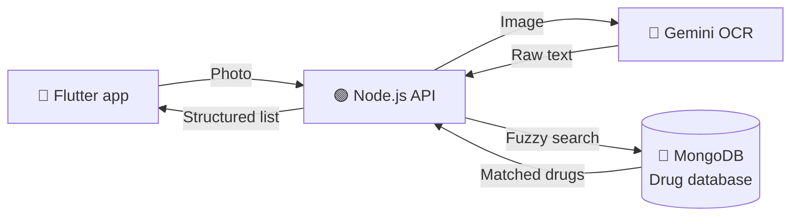

<div align="center">

# 💊 MedScan

### Scan a prescription. Understand every medication.

AI-powered prescription scanner built for the **Algerian pharmaceutical market**.


[Live Demo](#) · [Report a Bug](../../issues) · [Request a Feature](../../issues)

</div>

---

## 📖 About

Handwritten prescriptions are hard to read, and medication names in Algeria vary between brands, generics, and spellings. **MedScan** lets a user take a photo of a prescription and instantly get a clear, structured list of the medications, matched against a local drug database.

No more guessing what the doctor wrote.

## ✨ Features

- 📸 **Prescription scanning**: take a photo or upload an image from the gallery
- 🧠 **AI-powered OCR**: Gemini reads even messy handwriting
- 🔍 **Smart matching**: fuzzy search (Fuse.js) corrects spelling errors and finds the right drug
- 🇩🇿 **Built for Algeria**: matches medications available on the local market
- 📱 **Cross-platform**: one Flutter app for Android and iOS
- ⚡ **Fast results**: from photo to medication list in seconds

## 🎬 How It Works



1. The user captures a prescription in the app.
2. The image is sent to the Node.js backend.
3. Gemini extracts the medication names from the image.
4. Fuse.js matches each extracted name against the MongoDB drug database.
5. The app displays the matched medications.

## 🛠️ Tech Stack

| Layer | Technology |
|---|---|
| **Frontend** | Flutter (Dart) |
| **Backend** | Node.js, Express |
| **AI / OCR** | Google Gemini |
| **Database** | MongoDB |
| **Matching** | Fuse.js (fuzzy search) |

## 📂 Project Structure

```
medscan/
├── mobile/                 # Flutter app
│   ├── lib/
│   └── pubspec.yaml
├── backend/                # Node.js API
│   ├── src/
│   │   ├── controllers/
│   │   ├── routes/
│   │   ├── services/
│   │   └── utils/
│   ├── server.js
│   └── .env.example
└── README.md
```

## 🚀 Getting Started

### Prerequisites

- [Flutter SDK](https://docs.flutter.dev/get-started/install) 3.x
- [Node.js](https://nodejs.org/) 18+
- A MongoDB database (local or Atlas)
- A [Gemini API key](https://aistudio.google.com/)

### 1. Clone the repository

```bash
git clone https://github.com/<your-username>/medscan.git
cd medscan
```

### 2. Run the backend

```bash
cd backend
npm install
cp .env.example .env
npm run dev
```

### 3. Run the mobile app

```bash
cd mobile
flutter pub get
flutter run
```

> 💡 **Testing on a real phone?** Expose your backend with `ngrok http 3000` and use the HTTPS URL as the API base URL in the app.

## 🔐 Environment Variables

Create a `backend/.env` file:

| Variable | Description |
|---|---|
| `PORT` | Server port (default `3000`) |
| `MONGODB_URI` | MongoDB connection string |
| `GEMINI_API_KEY` | Google Gemini API key |

## 📡 API Reference

### `POST /api/scan`

Upload a prescription image and get the matched medications.

**Request**: `multipart/form-data`

| Field | Type | Description |
|---|---|---|
| `image` | file | Photo of the prescription |

**Response**

```json
{
  "success": true,
  "medications": [
    {
      "extracted": "Doliprane 1000",
      "match": "DOLIPRANE 1000 mg, comprimé",
      "score": 0.97
    }
  ]
}
```

## 🗺️ Roadmap

- [x] Prescription OCR with Gemini
- [x] Fuzzy matching on Algerian drug database
- [x] Cross-platform image upload (Android, iOS, web)
- [x] Live demo
- [ ] Dosage and frequency extraction
- [ ] Medication details (generic alternatives, usage)
- [ ] Scan history
- [ ] Arabic and French interface
- [ ] Pharmacy finder

## 🏆 Recognition

Submitted to Algeria's **Projet Innovant** label through startup.dz.

## 🤝 Contributing

Contributions are welcome.

1. Fork the project
2. Create your branch: `git checkout -b feature/amazing-feature`
3. Commit your changes: `git commit -m "feat: add amazing feature"`
4. Push: `git push origin feature/amazing-feature`
5. Open a Pull Request

## ⚠️ Disclaimer

MedScan is an assistive tool and does **not** replace professional medical advice. Always confirm your prescription with a doctor or pharmacist.

## 👩‍💻 Author

**Katia**
Computer Engineering student at ESI-SBA · Backend developer

[GitHub](https://github.com/katiaaitrahmoune) · [Portfolio](https://katiaaitrahmoune.github.io)

## 📄 License

Distributed under the MIT License.

---

<div align="center">
Made with ❤️ in Algeria
</div>
